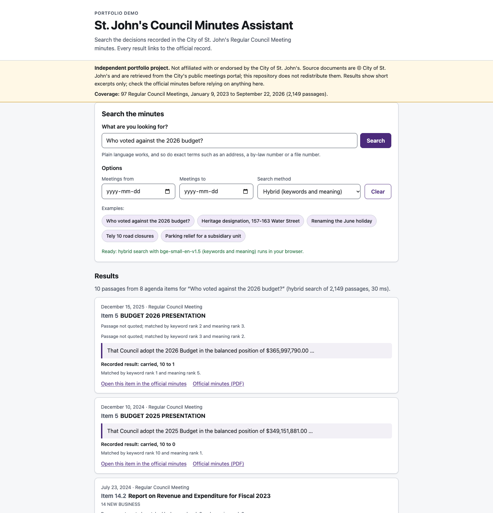
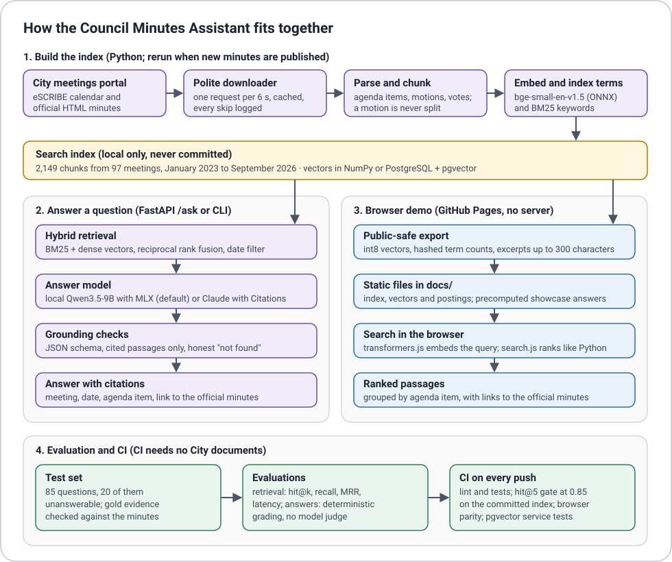

# St. John's Council Minutes Assistant

Ask a plain-language question about decisions recorded in the City of St. John's Regular Council
Meeting minutes and get a short answer that cites the meeting, date and agenda item, with a link
to the official record, or an honest "not found in the minutes".

[](https://github.com/mrw-soumik/stjohns-council-minutes-rag/actions/workflows/ci.yml)

**Live search demo:** https://mrw-soumik.github.io/stjohns-council-minutes-rag/ (runs entirely in
your browser; nothing you type leaves your device)



> Independent portfolio project. Not affiliated with or endorsed by the City of St. John's.
> Source documents are © City of St. John's and are retrieved from the City's public meetings
> portal; this repository does not redistribute them.

This is Project A of a three-part portfolio by Mostafa Rafiur Wasib. The
[business analysis](https://github.com/mrw-soumik/business-analysis-council-minutes-search)
(Project B) defines the requirements; this repository implements them and measures each one.

## Results at a glance

| Requirement | Target | Measured | Status |
|---|---|---|---|
| NFR-01 retrieval: correct passage in the top 5 | at least 85% of answerable questions | **95.4%** (62 of 65, hybrid) | Met |
| NFR-02 answers: citations that support the claim | at least 90% | **90.2%** cite the gold agenda item; 80.5% the exact gold passage (strict); 92.7% support a statement on read-through (82 citations) | Met at item level and on review; strict measure below |
| NFR-02 answers: unanswerable questions declined | at least 80% | **100.0% (20 of 20)** | Met |
| NFR-03 answer time, p95 (local model on an Apple M3 Pro) | under 10 s | **12.82 s** (k = 6); 10.96 s (k = 4) | Not met |
| NFR-03 demo search time after the page loads | under 1 s | **31 to 42 ms** per search | Met |
| NFR-04 cost per answer | under CAD 0.05 | **$0** (local model) | Met |
| NFR-05 accessibility (axe-core, WCAG 2.1 A and AA rules) | no violations | **0** in light, dark and 390 px views | Met |

Every number comes from a run recorded in [`eval/results`](eval/results/RESULTS.md); the commands
to reproduce them are in [`eval/README.md`](eval/README.md).

## How it works



1. **Ingest (FR-07).** `council-rag download` asks the City's eSCRIBE portal for the meeting
   calendar, keeps the Regular Council Meetings, and downloads each meeting's official HTML
   minutes: one request every 6 seconds, a descriptive User-Agent with a contact address, every
   file cached and never fetched twice, and every skipped meeting logged with a reason. A re-run
   fetches only what is new, keeps one entry per meeting, and appends a line to
   `data/logs/ingest.jsonl` with the updated coverage.
2. **Parse.** The minutes follow a stable template, so the parser reads each agenda item's number
   ("8.1.2"), title, anchor on the official page, discussion notes and motions (decision number,
   mover, seconder, wording, recorded votes and result such as `MOTION LOST (4 to 6)`), plus the
   attendance list.
3. **Chunk.** One agenda item per chunk; items longer than 250 words are split at block
   boundaries so a motion is never cut in half, and heading-only sections produce no chunk. The
   meeting and item path are added to the text that is indexed but never to the text that is
   quoted. Result: 2,149 chunks from 97 meetings, none longer than the embedding model's
   512-token limit.
4. **Retrieve (FR-04, FR-06).** BM25 finds exact terms (addresses, file and by-law numbers);
   `BAAI/bge-small-en-v1.5` embeddings find paraphrases; reciprocal rank fusion (k = 60) merges
   the two lists. The meeting-date filter is applied before ranking. Vectors live behind a
   `VectorStore` interface with an in-memory NumPy store (default) and a PostgreSQL + pgvector
   store.
5. **Answer (FR-01, FR-02, FR-03).** The default `local` backend runs
   [Qwen3.5-9B](https://huggingface.co/Qwen/Qwen3.5-9B) (4-bit MLX build) on the machine. A local
   model has no citations feature, so the app enforces grounding: passages are numbered, the
   model must reply with JSON (`answer`, `cited_passage_ids`, `found`) that is validated against
   a strict schema, an invalid reply gets one re-ask, cited numbers are mapped back to meeting,
   date, item and link, numbers that refer to no provided passage are dropped and recorded, and
   an answer without a valid citation is withheld as "not found". An optional `claude` backend
   uses the official `anthropic` SDK with Claude's Citations feature; it is covered by tests with
   mocked responses and was never called for this project.
6. **Browser demo (FR-05, NFR-03, NFR-05, NFR-07).** `council-rag export-demo` writes a
   public-safe index to `docs/data`: int8 vectors, BM25 term counts keyed by a hash (no readable
   word list), meeting metadata and excerpts. transformers.js 4.3.0 (pinned) embeds the query in
   the browser with the same model (its 8-bit weights, which gave the same hit@5), and `docs/assets/search.js` ranks exactly like the Python
   reader of that index (checked in CI for all evaluation questions).

### Why the official HTML minutes, and why agenda items instead of pages

The portal publishes minutes as PDF and HTML. Automated requests for the PDFs
(`FileStream.ashx`) receive a Cloudflare "Verifying your browser" challenge (HTTP 403). This
project does not try to get around that control: there is no browser automation and no header
spoofing. The calendar endpoint and the HTML minutes pages answer normally, and the downloader
stops at the first challenge instead of retrying. The HTML minutes carry the same record but no
page numbers, so citations name the meeting, date and **agenda item**, and link to that item's
anchor on the official page. Page numbers would be used only where a PDF had been legitimately
available. The PDF endpoint is still offered as an opt-in (`--pdf`) that stops at the first
challenge.

## Evaluation

The test set has 85 questions written from the minutes: 65 answerable (single facts, number
lookups, vote outcomes, date-filtered and paraphrased wording, across 2023 to 2026) and 20
plausible but unanswerable ones. Every gold reference is checked by code against the parsed
minutes (`council-rag verify-eval`). See [`eval/README.md`](eval/README.md) for provenance,
definitions and limitations.

### Retrieval (65 answerable questions)

| Configuration | hit@1 | hit@3 | hit@5 (95% CI) | recall@5 | MRR@10 | p50 / p95 latency |
|---|---|---|---|---|---|---|
| BM25 only | 0.646 | 0.908 | 0.923 (0.83 to 0.97) | 0.923 | 0.766 | 0.2 / 0.3 ms |
| Dense only (bge-small) | 0.708 | 0.815 | 0.923 (0.83 to 0.97) | 0.915 | 0.792 | 6.7 / 8.6 ms |
| **Hybrid (RRF)** | 0.661 | 0.892 | **0.954 (0.87 to 0.98)** | 0.946 | 0.787 | 6.0 / 7.4 ms |

Keyword search finds every exact-term question (52 of 52) but only 8 of 13 paraphrased ones;
dense search is even (0.92 on both); hybrid is best overall. The committed browser index (int8
vectors, hashed terms) and the browser's int8 query model give the same hit@5 of 0.954.

**Ablations** (one setting changed at a time, same 65 questions, so one or two questions is
noise): chunks of 400 words or dropping discussion notes raised hit@1 from 0.66 to about 0.82
with the same hit@5; RRF k = 10 raised hit@5 to 0.985 by recovering two date-filtered questions;
120-word chunks were worse (hit@5 0.923); int8 quantisation of vectors or of the query model
changed nothing. These were found on the development questions, so the defaults were kept and
the promising changes are listed under next steps.
[Full tables](eval/results/RESULTS.md).

### Answers (local model)

Run on Apple M3 Pro, 18 GB, macOS 27.0.1, with `Qwen3.5-9B (MLX 4-bit)`, greedy
decoding and deterministic grading (no model judge). k is the number of retrieved passages given
to the model.

| Metric | k = 6 (default) | k = 4 | Target |
|---|---|---|---|
| Answerable: strictly correct (required facts present and gold evidence cited) | 96.9% (63 of 65) | 90.8% (59 of 65) | |
| Answerable: required facts present | 96.9% (63 of 65) | 90.8% (59 of 65) | |
| Answerable: answered rather than declined | 96.9% (63 of 65) | 95.4% (62 of 65) | |
| Citations pointing to a gold-evidence passage (lower bound) | 80.5% of 82 | 78.5% of 79 | at least 90% |
| Citations pointing to the gold agenda item | 90.2% | 89.9% | |
| Unanswerable questions declined | 100.0% (20 of 20) | 100.0% (20 of 20) | at least 80% |
| Answer time p50 / p95 (retrieval + generation, model loaded) | 9.83 / 12.82 s | 7.92 / 10.96 s | p95 under 10 s |
| Mean prompt / output tokens | 1768 / 91 | 1262 / 92 | |
| Invalid JSON after one re-ask / re-asks needed | 0 / 0 | 0 / 0 | |
| Cost per answer | $0 | $0 | under CAD 0.05 |

**What the automatic grades miss.** The grader checks required facts and citations; it cannot
see a false statement added next to correct facts. A read-through of all 63 answers at k = 6
([notes](eval/results/answers_local_k6/review.md); done by the author's AI assistant, not yet by a
person) found two factual errors that the grader passed (`sf10` says a decision was rescinded when
the rescinding motion lost; `nl03` opens with "seven food trucks" where there were five) and two
answers that misdescribe a motion while giving the right outcome (`vo06`, `df02`). Counting the two
factual errors, strict correctness at k = 6 would be 61 of 65. Of the
16 citations that miss the gold passage, 10 support another true statement
in the answer (for example a later decision at the same address), 3 are background only and 3
accompany a misstatement: on review, 76 of 82 citations (92.7%) support a statement in their
answer, against the automatic 80.5% (gold passage) and
90.2% (gold agenda item).

**One grader fix.** The first grading pass marked `vo01` wrong because the model wrote "1 in
favor and 8 against" where the key said "1 to 8". The grader now rewrites vote counts written in
any common form to "X to Y" before matching (unit-tested), which changed that one grade. Grades
are recomputed from the saved rows with `council-rag eval-answers --summarise-only`.

**Misses at k = 6.** `df05`, `pa04` are retrieval misses: the gold passage was not among the passages given to the model, which then declined rather than guess.

Model load and warm-up took 7.54 s once per process and is not
included in answer time. Per-question rows and grades: [`answers_local_k6`](eval/results/answers_local_k6/results.jsonl),
[`answers_local_k4`](eval/results/answers_local_k4/results.jsonl).
Twelve answers chosen before the run are shown in the demo exactly as generated
([`docs/data/showcase.json`](docs/data/showcase.json)).

## Automated checks (traceability IDs from Project B)

| ID | Check | Result |
|---|---|---|
| PA-01 | Retrieval hit@5 overall and for exact-term vs paraphrased questions, per method | Keyword 0.923 (exact 1.000, paraphrased 0.615); semantic 0.923 (0.923, 0.923); hybrid 0.954 (0.962, 0.923) |
| PA-02 | Retrieval by year and by format | Hybrid hit@5: 2023 0.966, 2024 0.917, 2025 1.000, 2026 0.917; HTML 0.954; PDF not applicable (PDF endpoint blocked for automated clients) |
| PA-03 | Share of citations that support their claim | Automatic: 90.2% of 82 citations point to the gold agenda item and 80.5% to the exact gold passage (strict lower bound); read-through: 92.7% support a statement in their answer (k = 6; target 90%) |
| PA-04 | Share of unanswerable questions declined | 100.0% (20 of 20) declined (k = 6; target 80%) |
| PA-05 | p95 end-to-end answer time | 12.82 s at k = 6 and 10.96 s at k = 4 on Apple M3 Pro, 18 GB (target under 10 s) |
| PA-06 | Demo search time after page load | 31 to 42 ms per search once the model is ready (headless Chrome); in that run keyword search was ready 56 ms after navigation and the model (34 MB, first visit) after 5342 ms |
| PA-07 | Cost per answer | $0: the answer model runs locally (electricity not measured) |
| PA-08 | Automated accessibility scan | axe-core 4.13.0, WCAG 2.0/2.1 A and AA rules: 0 violations (desktop light, desktop dark, 390 px) |
| PA-09 | Logs contain no IP address or identifier | Pass: `tests/test_privacy.py` (usage log fields are whitelisted; server access log disabled) |
| PA-10 | UI shows disclaimer, coverage dates, model name and independence notice | Pass: independence notice shown, disclaimer shown, coverage dates shown, search model name shown, answer model name shown (checked in headless Chrome) |
| PA-11 | Every answer has a citation with meeting name, date, item and a valid official URL | Pass: 82 of 82 citations in 63 answers (k = 6) have meeting name, date, agenda item and an official minutes URL whose anchor exists on the page |
| PA-12 | No retrieved passage outside the selected date range | Pass: 0 violations in all retrieval runs, the browser index, the API tests and the answer run (0 violations over 11 date-filtered questions) |
| PA-13 | Every excerpt is at most 300 characters and a verbatim substring of its source | Pass: checked for all 2,149 published excerpts at export time (`council-rag export-demo` refuses otherwise) and in tests |
| PA-14 | Ingestion re-run: no duplicates, writes a log, updates coverage | Pass: `tests/test_escribe.py::test_rerun_adds_new_minutes_without_duplicates_and_logs` |

## Requirements traceability

| ID | Implemented in | Measured result |
|---|---|---|
| FR-01 Answer questions about the minutes | `answers.py`, `local_llm.py`, `generation.py`, `api.py` (`/ask`), `cli.py` (`ask`) | 96.9% (63 of 65) of answerable questions pass the strict automatic check (61 of 65 after two factual errors found on read-through) |
| FR-02 Cite meeting, date, item; link to the official record | `local_llm.py` (citation mapping), `chunking.py` (item anchors) | PA-11 above |
| FR-03 Say "not found" instead of guessing | `local_llm.py`, `generation.py` | 100.0% (20 of 20) of unanswerable questions declined; 2 of 65 answerable questions were also declined |
| FR-04 Filter by meeting date | `retrieval.py`, `vectorstore/`, `docs/assets/search.js` | PA-12: no out-of-range result in any run |
| FR-05 Show source excerpts next to results | `chunking.py` (`excerpt_for`), `api.py`, demo | PA-13 |
| FR-06 Hybrid retrieval | `bm25.py`, `embeddings.py`, `retrieval.py` | hit@5 0.954 hybrid vs 0.923 for either method alone |
| FR-07 Repeatable ingestion | `ingest/escribe.py`, `cli.py update` | PA-14 |
| NFR-01 hit@5 at least 85% | `evaluation/retrieval_eval.py`, CI gate | 0.954, gated in CI on the committed index |
| NFR-02 citations at least 90% supported; at least 80% declines | `evaluation/answer_eval.py` | 80.5% of citations hold gold evidence (lower bound); 100.0% of unanswerable questions declined |
| NFR-03 p95 answer under 10 s; demo search under 1 s | `answer_eval.py`, `scripts/screenshots.mjs` | answers p95 12.82 s (k = 6) and 10.96 s (k = 4) on Apple M3 Pro; demo search 31 to 42 ms |
| NFR-04 cost under CAD 0.05 per answer | `pricing.py`, usage log | $0 with the local model; the Claude backend logs cost per call |
| NFR-05 WCAG 2.1 AA | `docs/`, `scripts/screenshots.mjs` | PA-08: 0 axe-core violations; keyboard path checked |
| NFR-06 Privacy | `answers.py` (usage log), `cli.py serve` | PA-09 |
| NFR-07 Disclaimer, coverage dates, model name in the UI | `docs/index.html`, `docs/assets/app.js` | PA-10 |

## Quick start

Requires Python 3.11 or later (developed on 3.14) and, for the browser checks, Node 20 or later.

```bash
python3 -m venv .venv && source .venv/bin/activate
pip install -e ".[dev]"            # add ,pgvector for the PostgreSQL store, ,local for MLX answers

council-rag download               # about 10 minutes the first time (polite rate), cached afterwards
council-rag parse
council-rag build-index            # downloads the pinned embedding model (about 130 MB) once
council-rag search "Who voted against the 2026 budget?"
council-rag search "Tely 10 road closures" --from 2024-01-01 --to 2024-12-31

pip install -e ".[local]"          # Apple silicon: MLX and the answer model runtime
council-rag ask "Did council approve the outdoor lounge at 75 Airport Heights Drive?"
council-rag serve                  # FastAPI on http://127.0.0.1:8000 (/health, /search, /ask)

council-rag update                 # later: fetch newly published minutes and rebuild
```

To preview the demo locally: `python -m http.server -d docs 8000` and open
http://127.0.0.1:8000/.

### The local answer model

| | |
|---|---|
| Model | `mlx-community/Qwen3.5-9B-MLX-4bit` at revision `938d8919`, a 4-bit MLX build of Qwen3.5-9B |
| Licence | Apache-2.0 |
| Download | 5.98 GB, stored in `.cache/huggingface` inside the project (gitignored) |
| Runtime | `mlx-lm` 0.32 on Apple silicon; peak memory about 6.7 GB; greedy decoding, thinking mode off |
| Measured on | Apple M3 Pro, 18 GB, macOS 27: prompt processing about 245 to 275 tokens/s, generation about 27 tokens/s |

Set `COUNCIL_RAG_LLM_BACKEND=claude` (plus `ANTHROPIC_API_KEY`) to use Claude instead; this
calls a paid API. The Claude path uses `claude-opus-5-5` with Citations, adaptive thinking at
an explicit effort, server-side refusal fallbacks, and logs tokens and cost per call.
An estimate from the exact requests this backend would build for the 85 questions (about 2,303 input tokens each at 3.5 characters per token, not measured) puts one answer at USD 0.013 to 0.033 (CAD 0.018 to 0.046 at an assumed 1.40 CAD per USD), depending on how long Claude thinks; a full evaluation run would cost about USD 1.12 to 2.82 ([estimate](eval/results/claude_cost_estimate.json)).

### pgvector

The pgvector store is tested in CI against the `pgvector/pgvector:pg16` service image. Docker
was not available on the development machine, and the `pgserver` package publishes no wheels
for Python 3.14, so the same test was run locally against the PostgreSQL 16 and pgvector 0.6.2
binaries bundled in `pgserver`'s wheel:

```bash
export PGVECTOR_TEST_DSN=postgresql://postgres@127.0.0.1:54329/council_test
pytest -m integration
```

Use it in the app with `COUNCIL_RAG_VECTOR_STORE=pgvector` and `COUNCIL_RAG_PG_DSN`.

## Data, privacy and copyright

* City documents are © City of St. John's (all rights reserved). They are downloaded for local
  use into `data/`, which is gitignored; neither the PDFs nor the full text are committed.
* The public demo shows only excerpts: each is a verbatim span of the minutes of at most 300
  characters, linked to the official page. Together the 2,149 excerpts amount to about 26% of
  the parsed minutes text, mostly the wording of motions. The demo index also holds int8
  vectors and BM25 term counts keyed by a hash rather than readable words.
* Precomputed demo answers are short model-written sentences with links to the official items.
* No accounts, cookies or analytics. The demo processes searches in the browser. The API keeps
  only usage and cost per answer (no question text, IP address or identifiers), and the server
  runs with its access log off.

## Limitations

* **Small test set.** 65 answerable questions give confidence intervals of about plus or minus
  7 points; the questions were drafted with an AI assistant and checked by code, not yet
  reviewed by a person, and lean toward 2023 (29 of 65).
* **Development-set reuse.** The ablations and the chosen defaults were evaluated on the same
  questions; there is no held-out set yet.
* **Citation precision is a lower bound.** A citation to a passage that supports the claim but
  is not the gold item counts as unsupported; no model judge was used.
* **Answer latency** depends on the machine; on an Apple M3 Pro the p95 was 12.82 s with six passages and 10.96 s with four. Time is mostly spent reading the prompt (about 245 to 275 tokens per second).
* **Agenda items, not pages.** Page numbers are unavailable while the PDF endpoint blocks
  automated clients.
* **Coverage.** Regular Council Meetings only (not Committee of the Whole), January 2023 to
  September 2026; 10 meetings had no minutes posted when the data was collected.

## Next steps

* Validate 400-word chunks and RRF k = 10 on a new held-out question set before adopting them.
* Have a person review a stratified sample of the questions and of the graded answers.
* Reduce answer latency: fewer or shorter passages, prompt caching for the fixed instructions,
  streaming the answer, or a smaller model; measure each against the same grades.
* Add Committee of the Whole minutes, which often hold the discussion behind a decision.
* Offer page-level links if the City publishes PDFs in a form automated clients can retrieve.

## Repository layout

```
src/council_rag/      ingest (downloader, HTML parser), chunking, retrieval, answers, API, CLI
eval/                 questions.jsonl, qrels.json, results/ (JSON runs and RESULTS.md)
docs/                 static demo (GitHub Pages), architecture.svg, screenshots
scripts/              parity checks, browser checks, showcase and results generators
tests/                pytest suite with a synthetic minutes fixture (no City documents)
```

## Licence

Code and documentation: [MIT](LICENSE). City of St. John's documents and material taken from
them are not covered by this licence; see the scope note in the licence file.
